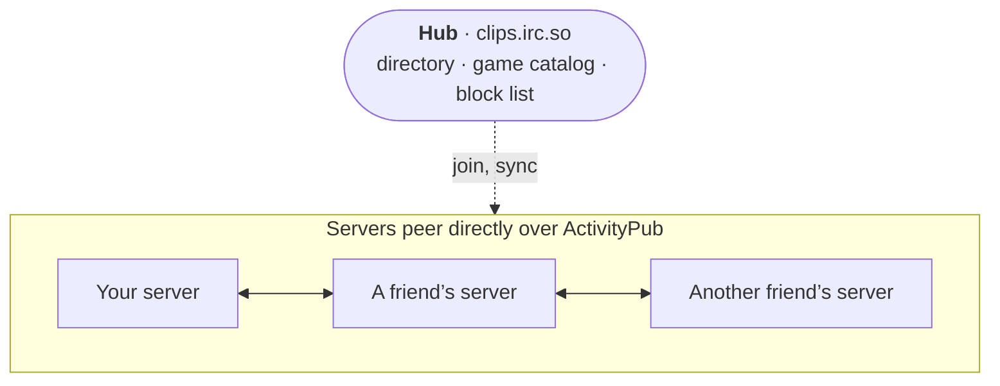

# Network

Each person runs their own server and hosts their own clips. Servers in a network see each other's public
clips under **Network**, on Home and in search, and people can like, comment on and subscribe to clips on any
of them.

- [In plain words](#in-plain-words)
- [How it works](#how-it-works)
- [What you see](#what-you-see)
- [Joining](#joining)
- [The Network admin page](#the-network-admin-page)
- [What every server controls](#what-every-server-controls)
- [Lockdown](#lockdown)
- [Blocking and unlinking servers](#blocking-and-unlinking-servers)
- [Sharing what you follow](#sharing-what-you-follow)
- [Block lists](#block-lists)
- [Leaving](#leaving)
- [Running a hub](#running-a-hub)
- [Under the hood](#under-the-hood)
- [Testing several servers on one machine](#testing-several-servers-on-one-machine)

## In plain words

Think of a group of friends who each run an OurTube. On its own, each one only shows its own videos. Linked into
a network, every server also shows the others' public videos, next to its own, as if they were one big site:

- you browse and search everyone's clips from your own server, with your own account;
- you like, comment on and subscribe to a friend's clip without making an account on their server;
- each video still lives on, and plays from, the server it was uploaded to. Nothing is copied.

A **hub** is the server everyone joins first (for the OurTube network that is [clips.irc.so](https://clips.irc.so)).
It introduces servers to each other and keeps a shared game list and block list. After that, servers talk to
each other directly, so the network keeps working even if the hub goes away.

Being in a network is off until a server's admin joins one. Members don't have to do anything: once their server
is in, the network's videos simply show up.

## How it works



- **Video files are never copied.** Viewers stream a clip from the server that hosts it. What travels between
  servers is the clip's details (title, thumbnail, game, counts) and the interactions.
- **Servers peer directly**, over ActivityPub (since OurTube 1.3): their instance actors follow each other,
  new clips arrive within seconds, and every round each server reads its peers' outboxes so nothing is missed.
- **Likes, comments and subscriptions** go to the server hosting the clip, so counts and comment threads are the
  same everywhere. That server answers each comment (shown, held for review, or refused). People from elsewhere
  appear as `name@their.host` and link back to their home server.
- **The hub is optional.** It is the easy way in, keeps the directory of servers, the network's
  [game catalog](Video-Tools-and-Games.md#the-networks-game-catalog) and a block list the members follow, and
  it can moderate the whole network. If the hub goes offline, gets a legal notice or shuts down, the other
  servers keep seeing each other and keep liking and commenting.
- **Only public, ready clips with *Share with the network* ticked are ever listed.** The tick is in each video's
  details (see [Uploading and Editing](Uploading-and-Editing.md#video-details)); unticking it keeps a public clip
  on its own server only.
- **One person with accounts on several servers** can link them, so every server shows them as one person
  (*Also on*, one *Subscribe to all*, the uploader's mark on their comments). See
  [Linked accounts](Fediverse.md#linked-accounts).

## What you see

Once your server is in a network, these show up for everyone on it, signed in or not.

**A tag on every video.** Each video card has a tag on its thumbnail with the name of the server it lives on and
a colored dot (your own server's videos too). The same server has the same color on every server, since the color
comes from its address. Hovering the tag says *On this server (clips.example.com)* or *On clips.example.com, a
PeerTube server*. Watch pages (next to the subscriber count), channel pages and live cards show the server the
same way.

**Network videos everywhere.** Home mixes in videos from the other servers; its **This site** chip shows only
this server's. Search has a filter for where to look: **Everywhere**, **This site**, **Other instances**, or one
server, listed under **OurTube servers** or **Fediverse**. Game pages include the network's videos of that game, and
**Live now** on Home includes streams on other servers ([Live Streaming](Live-Streaming.md#live-on-other-servers)).

**The Network page.** **Network** in the sidebar (`/network`) is there once your server is in a network, or follows
anything on the fediverse. It is titled with the network's name and shows the hub's announcement, if there is one.
The chips across the top filter it:

| Chip | Shows |
| --- | --- |
| **All instances** | The newest videos from every other server |
| **Most viewed** | The same, most viewed first |
| One chip per server | Only that server's videos (*Showing clips from …*). OurTube servers come first, then, after the **Fediverse** label, the fediverse servers followed from here. Hovering a chip shows its address and what it runs. |

A server that asked to join and is waiting shows *Waiting for the network* there, and one outside any network
*Not part of a network* (admins get a **Network settings** button).

**A video from another server** opens at `/n/<server>/<video>` and plays straight from its own server. The page
says *Hosted on <server>. Your likes, comments and subscriptions go to that instance, and its people see them too.*
with an **Open the original** link. Compared with a video from here:

- **Like**, **Subscribe** and comments go to that server. When the network has turned one of them off, the
  button is missing or says so (*Likes between instances are turned off*, *Comments between instances are turned
  off on this network.*).
- A comment you post shows *Waiting for <server>* until that server accepts it (usually within a second), or
  *Not accepted* with its reason.
- **Share** copies the link to the original, and the open button opens it on its server.
- **Save**, **Watch together** and compare work as usual. **Clip**, exports and downloads aren't there.
- The channel name and picture open the channel on its own server, and the side column lists *More from
  <server>*.
- Admins get a shield menu: **Hide on this site** (**Hide from the network** on the hub) and **Block <server>**.

Channels you subscribe to on other servers are listed in the sidebar like the rest, with a globe mark, and open on
their own server.

## Joining

You need a Public URL with `https://` (Admin → Overview), reachable from the internet. Then **Admin → Network
→ Join a network**: enter the hub's address (`https://clips.irc.so` by default) or the address of any server
already in the network in **Hub or instance address**, and click **Join network**; the rest are found from there.
From the command line:

```bash
docker exec cliptube node server/cli.js network join https://clips.irc.so
```

What happens next is in the message that pops up:

| Message | Meaning |
| --- | --- |
| *Joined OurTube Network* | The hub let you in. Other servers' videos appear within a sync round. |
| *Join request sent; the hub admin needs to approve it* | The hub requires approval. The page shows **Waiting for the hub to approve** until it does. |
| *Connected to the network* | You joined through a server that isn't a hub, and it accepted you. |
| *Request sent; the instance admin needs to accept it* | That server asks its admin first. |

Once in, other servers' videos appear within a sync round, and the hub's games show up under Admin → Games.
If joining fails, see [Troubleshooting](Troubleshooting.md#the-network).

From then on every video carries its server's tag, and the Network page fills up (see [What you see](#what-you-see)).

A channel's picture, name and bio follow it everywhere: a change is sent to the servers in the network right
away, and each server also reads the channels it shows again every 12 hours (all of them on *Sync now*), for
servers that don't send their changes.

## The Network admin page

**Admin → Network** (`/admin/network`, admins only), from top to bottom:

1. **The heading** carries a badge: **This instance is the hub**, or your membership: **Connected**, **Waiting for
   the hub to approve**, **Suspended by the hub**, **Banned by the hub** or **Removed from the network**.
2. ***This instance's address***, the address other servers use. When it is taken from the browser rather than the
   Public URL, a hint says so; *Networks need HTTPS* appears when it isn't `https://`.
3. **Join a network** (not on the hub):
   - Not in a network: **Hub or instance address** and **Join network** (see [Joining](#joining)).
   - In a network: the network's name; *Hub:* and its address, or *No hub: connected through direct peers*; your
     status (**Connected** or **Waiting for peers** without a hub); *Hub says:* with the hub's note to you; the
     hub's announcement; **Clips from other instances** (how many are listed here); **Last sync**; **Network
     allows** (comments, likes, subscriptions, or *browsing only*); *Last sync failed:* with the error. Then **Sync
     now**, **Leave hub only** and **Leave network** (see [Leaving](#leaving)).
   - **Accept from other instances**: **Comments**, **Likes** and **Subscriptions**. Turning one off refuses it from
     every other server, OurTube or fediverse, even where the network allows it.
4. **Run the network (hub mode)**: **This instance is the hub**, greyed out while you are a member (*Leave your
   current network first.*). Turned on, the hub's settings appear under it (see [Running a hub](#running-a-hub)).
5. **Fediverse sharing**: **Share what this server follows** and **Show what other servers share** (see [Sharing
   what you follow](#sharing-what-you-follow)).
6. **Instances in the network** (on the hub only), with **Sync all** (see [Running a hub](#running-a-hub)).
7. **Direct peers** (while in a network or running a hub), titled with how many are connected and waiting:
   - a box for an address and **Peer with it**, to peer with any server yourself;
   - every peer, with its state both ways. Your side: **Accepted**, **Asked to peer** (waiting for you) or
     **Declined**. Theirs: **Accepts us**, **Waiting for them**, **Declined us** or **Left the network**. Both ways
     accepted shows **Connected**. Also **In the hub** (listed by your hub) and **Older version** (an OurTube too old
     to peer directly; reached through the hub only);
   - under the name: its address, how many clips, when it last synced (or *not synced yet*), how it was found
     (*found through a peer*, *from the hub*, *asked us*), and its last error;
   - **Accept** and **Decline** for a server that asked; **Accept** for one you declined before; the × (*Forget
     this peer*) to drop it (see [Blocking and unlinking servers](#blocking-and-unlinking-servers)).
8. **Who can peer with this instance**: **Accept new instances**, **Ask me first** and **HTTPS only** (on the hub,
   a note that the hub's joining switches decide instead); **Publish my block list**; **Most peers** with **Save**.
   See [Lockdown](#lockdown) and [Block lists](#block-lists).
9. **Block lists you follow** (see [Block lists](#block-lists)).
10. **Fediverse (ActivityPub)**: Mastodon, PeerTube and following whole servers. See [Fediverse](Fediverse.md).
11. **Blocked instances**: block a server by address, and the servers you blocked, with **Block** and **Unblock**
    (see [Blocking and unlinking servers](#blocking-and-unlinking-servers)).
12. **Hidden videos** (when you hid any): network videos you hid, each with **Show again**.

## What every server controls

Every server stays in charge of itself. Under **Admin → Network** each one can:

- **peer with any server directly** (*Direct peers → Peer with it*), and see each peer's state both ways;
- **decide who may peer with it**: accept new servers (turning it off is a lockdown), ask first, HTTPS only, and
  a limit on peers;
- **block any server**, which hides its clips and refuses its likes, comments and subscriptions;
- **turn off accepting** comments, likes or subscriptions from other servers;
- keep a single public clip off the network by unticking **Share with the network** on it.

Failing peers are retried with a growing delay (from one minute, doubling, up to six hours).

## Lockdown

A lockdown stops new servers from coming in, without touching the ones already in.

- **On your own server:** Admin → Network → **Who can peer with this instance** → turn off **Accept new
  instances** (*Locked down*). Servers you already peer with keep working; nobody new gets in. This also covers a
  PeerTube server that tries to follow your whole server.
- **Softer:** leave it on and turn on **Ask me first**. New servers then wait in **Direct peers** as **Asked to
  peer** until you click **Accept** or **Decline**.
- **On the hub:** **Run the network (hub mode)** → **Joining** → turn off **Accept new instances** and click **Save
  hub settings**. That locks the whole network: members keep working, and no new server can join (*Turn off to lock
  the network down. Existing members keep working.*). A server you remove can't come back while it is locked.
- **HTTPS only** (on by default, on both) refuses servers that aren't served over HTTPS.

Turn **Accept new instances** back on to open up again.

## Blocking and unlinking servers

**Blocking** a server hides its videos here and refuses likes, comments and subscriptions from its people. It
works on any server, OurTube or fediverse (Mastodon, PeerTube...), and refuses its ActivityPub traffic too. Three
ways to block:

- **Admin → Network → Blocked instances**: type its address (`clips.example.com`) and click **Block**. It works for
  a server you haven't seen yet.
- **Block** next to a server in that list (it lists the servers in your hub's network). A reason is asked for,
  which only you see.
- On one of its videos: the shield menu → **Block <server>**.

Blocked servers show a **Blocked** badge with your reason; *from a list you follow* marks blocks that came from a
block list. **Unblock** lifts a block. On the hub, banning a member removes it from the whole network instead (see
[Running a hub](#running-a-hub)).

**Hiding one video:** on its page, the shield menu → **Hide on this site** (on the hub, **Hide from the network**,
which hides it for every member). Hidden videos are listed under **Hidden videos**, with **Show again**.

**Declining or forgetting a peer:**

- **Decline** on a server that asked to peer turns it down, and its videos leave.
- The × on a peer (*Forget this peer*) drops the peering and its clips disappear here until you peer again. A
  forgotten server can turn up again through the hub or another peer; block it to keep it out.

To stop being part of the network altogether, see [Leaving](#leaving).

## Sharing what you follow

The network shares every server's own uploads. What a server follows in the fediverse (PeerTube channels and
whole PeerTube servers) stays on that server, unless both sides opt in to **fediverse sharing** under
**Admin → Network → Fediverse sharing**:

- **Share what this server follows** passes those videos on to the other OurTube servers.
- **Show what other servers share** shows the videos peers pass on, tagged with the server that hosts them. The
  switch's hint says how many are here now.

With both on across the network, every server's follows add to everyone's catalog, a mesh where no server has to
follow everything itself. Details:

- A server that takes shares reads each video from its own server, never from the peer that passed it on, and
  likes, comments and subscriptions go straight to that server. Videos marked sensitive (NSFW) stay out.
- New uploads arrive within moments; the full list is read at each network round (a hundred new videos a round,
  up to 2,000 per peer).
- Sharing goes one hop: a server doesn't pass on what it got from its peers.
- A video leaves when no peer shares it any more, when a peer stops sharing or leaves, or at once when a server
  turns off **Show what other servers share**. Videos a server follows itself stay either way.
- Site-wide webhooks that include the network's videos also post the shared ones that arrive new.

## Block lists

A server can **publish its block list** and **follow other servers' lists**, applied automatically or after
your review. Members follow their hub's list automatically, so the hub's bans and network-wide hides reach them
even though they fetch clips from peers directly. A block that came from a list is lifted when its source lifts
it.

- **Publishing:** **Who can peer with this instance** → **Publish my block list** (on by default). Your blocks,
  with your reasons, are then readable at `/api/network/blocklist`.
- **Following:** **Block lists you follow** → the server's address, **Review first** or **Apply automatically**,
  then **Follow**. Each list shows **Automatic** or **Review**, how many entries were applied, how many are
  waiting and when it was last checked.
- **Reviewing:** waiting entries are listed under their list, each with **Apply** and **Ignore**.
- Each list has a button to switch between **Review first** and **Apply automatically**, the refresh button
  (*Check now*) and the × (*Stop following*), which lifts the blocks that came from it.

```bash
docker exec cliptube node server/cli.js network follow-blocklist https://clips.irc.so --mode review
```

## Leaving

- **Leave hub only** keeps your direct peers and stops using the hub.
- **Leave network** disconnects from everything: other servers' clips disappear from this site, and yours from
  theirs. Your own clips are untouched.

Both ask for a confirmation. Games that came from the hub stay, as your own.

```bash
docker exec cliptube node server/cli.js network leave --keep-peers    # hub only
docker exec cliptube node server/cli.js network leave                 # everything
```

## Running a hub

A hub is an ordinary OurTube server that other servers join. To start a network of your own, set the Public URL
to your `https://` address, make sure the server isn't in another network, and turn on **Admin → Network → Run the
network (hub mode) → This instance is the hub** (or `network hub-enable <your-public-url>`). Other servers then
join with your address. Turning it off again asks first: *Every instance in the network loses access to the shared
index until you turn it back on.*

The hub's settings appear under the switch, in this order, and are saved with **Save hub settings**:

| Setting | Default | What it does |
| --- | --- | --- |
| Network name | OurTube Network | The name members show on their Network page and Admin → Network |
| **Joining:** Accept new instances | on | Turn off to lock the network to its current members |
| Require my approval | off | New servers wait until the hub admin approves them (greyed out while joining is off) |
| HTTPS only | on | Refuse servers not served over HTTPS (these three switches also decide who may peer with the hub) |
| **Across the whole network:** Comments / Likes / Subscriptions between instances | on | Network-wide switches for each kind of interaction |
| Include this instance's videos | on | Share the hub's own public clips with the network |
| Max videos per instance | 5000 | Cap on how many clips one server can put in the index |
| Sync every (minutes) | 10 | How often the hub and members refresh (changes are also pushed within seconds), 1 to 1440 |
| Announcement | empty | A banner on the Network page of every server |

**Instances in the network** lists every member, with **Sync all** to pull them all now. Each one shows its status
(**Active**, **Waiting for approval**, **Suspended** or **Banned**), **Videos hidden** and **No likes or comments**
when you set those, its address, clip count, when it joined, when it was last seen, its OurTube version, your note
and its last error. The buttons:

| Button | What it does |
| --- | --- |
| **Approve** | Lets a waiting server in |
| **Suspend** | Drops it from the network for a while. Asks for a reason, shown to them |
| **Unsuspend** / **Unban** | Makes it active again |
| **Ban** | It can't rejoin until you unban it. Asks for a reason |
| More → **Stop its likes and comments** / **Allow its likes and comments** | Its people can still watch, but not interact |
| More → **Hide its videos from the network** / **Show its videos in the network** | Takes its clips out of every member's index |
| More → **Sync now** | Pulls that server now |
| More → **Remove from the list** | Removes it; it can join again later unless the network is locked |

Any single network clip can be hidden too, from its page (**Hide from the network**). Bans and hides go out through
the hub's block list, so they reach every member.

The hub also keeps the network's game catalog, and with a SteamGridDB key its artwork (see
[Video Tools and Games](Video-Tools-and-Games.md#game-artwork-from-steamgriddb)).

## Under the hood

Protocol version 4, in short:

- `GET /.well-known/cliptube` describes a server: its admission switches and its instance actor.
- **Peering, clips and interactions are ActivityPub**, with a few OurTube extensions. The full design is in
  [docs/federation.md](https://github.com/JawshTheDark/ourtube/blob/main/docs/federation.md).
- **The instance layer is plain JSON over HTTPS:** `GET /api/network/known-peers` exchanges peer lists (signed
  with each server's Ed25519 key and checked at its own address), `GET /api/network/blocklist` publishes blocks,
  and members register with the hub (`POST /api/hub/join`, with a nonce callback to `/api/network/verify`) and
  read its directory, switches and game catalog (`/api/hub/directory`, `/api/hub/status`, `/api/hub/games`).
- Servers on OurTube 1.2 and earlier (protocol v3) are still understood during the transition: a newer server
  serves its v3 feed to them, reads theirs, and moves each one to ActivityPub once it has upgraded.
- `GET /api/site` lists the servers whose videos show here in `network_peers`, each with `software`: `ourtube`
  for OurTube servers, otherwise what the server's NodeInfo says (`peertube`, `mastodon` ...), or `null` until
  it has been read (each network round reads a few). Apps use it to tell OurTube servers from the rest of the
  fediverse; the Network page and search list them apart.

Check a server's view of the network at any time:

```bash
docker exec cliptube node server/cli.js network status
docker exec cliptube node server/cli.js network sync     # sync now and show the result
```

The other network commands (`network peer <url>`, `network hub-enable`, `network hub-disable`) are listed in
[Admin CLI](Admin-CLI.md#network).

## Testing several servers on one machine

The network refuses to contact private addresses (localhost, LAN), so a test network on one machine needs
`--allow-private-federation` (or `FEDERATION_ALLOW_PRIVATE=1`) on every server:

```bash
DATA_DIR=./data-a PORT=3001 node server/index.js --allow-private-federation
DATA_DIR=./data-b PORT=3002 node server/index.js --allow-private-federation
```

Never use it on a public server. `npm run dev` turns it on for you.
